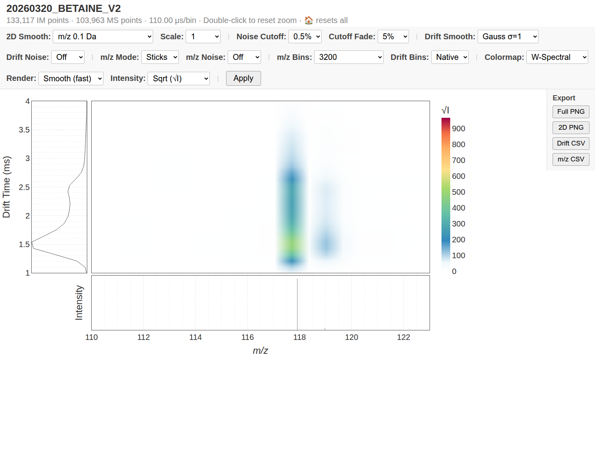

# Real Waters production demos

Nine complete acquired Waters RAW folders (300.29 MiB) cover three practical workflows. They include instrument metadata, function data and existing reader sidecars. No acquisition was synthesized, shortened or stripped to make it smaller.

Open the Waters workspace, choose a demo, choose a writable output folder, then process the selected runs. Generated data and viewers belong in the output folder. Each demo supplies its own viewer settings; the calibration and analyte tables are optional inputs where supplied.

| Demo | Real runs | RAW size | What it exercises |
| --- | ---: | ---: | --- |
| Protein standards + ADP | 5 | 195.07 MiB | Three protein standards, two ADP solution conditions, batch processing, calibration review and 34 target rows |
| Tune mix + Betaine | 2 | 40.68 MiB | Six Hexakis references, calibration and independent analyte processing |
| Native HSP104 pair | 2 | 64.55 MiB | High-mass viewing, different drift timing, linked profiles and run comparison |

The Betaine viewer was also checked in Chrome with network access disabled, including display changes and heatmap zoom updating both linked profiles.



## The acquired data

- Protein standards: `20260216_UBQ_DEN_NEW_V1`, `20260216_CYTC_DEN_NEW_V1`, `20260216_MYO_DEN_NEW_V1`.
- ADP conditions: `20260212_200UM_ADP_1M_EDDA_PH6_0`, `20260212_200UM_ADP_200MM_AMAC`.
- Small molecules: `20260320_AGILENT_TUNE_MIX_V2`, `20260320_BETAINE_V2`.
- Native protein: `20260901_HSP104_1_2_ATPYS_2`, `20260901_HSP104_6_2P5_ATPYS_1`.

[demo_manifest.json](demo_manifest.json) lists every file, byte count, SHA256 hash, original header and relevant instrument settings. Its paths resolve beside the manifest. Table `raw_path` values resolve beside their CSV, so moving the demo folder preserves the configuration. Some original protein/ADP header dates report 2009 despite later filename prefixes; both are preserved, and the prefixes are not evidence of acquisition chronology.

## Recorded execution and calibration limits

All nine acquisitions converted at their original mass resolution and produced enhanced HTML viewers with Plotly embedded. Each viewer includes mass and drift bin controls, profile/stick display, cutoff fade, smoothing and intensity scaling. That nine-run check ran on Linux through Wine; [validation.json](validation.json) retains its run counts, output sizes and checks.

The updated source and frozen Windows Console also passed with the two complete tune-mix/Betaine RAW acquisitions: six calibrant peaks, one finite analyte CCS result, ten PNG outputs, and both offline viewing routes. The native console fitted a 1280 × 800 display, and the build verified all nine bundled acquisitions against 148 original file hashes. See [Windows native evidence](https://github.com/AlanineX/deconvovo/releases/download/v0.3.0/native_smoke.json). These checks establish software execution; the scientific calibration limits below still apply.

| Calibration demo | Accepted software peak rows | Reported log-fit score | Reference peak drift interval | Application limit |
| --- | ---: | ---: | --- | --- |
| Protein standards + ADP | 25 | 0.874117 | 4.785–8.745 ms | Poor calibration fit; 30 of 34 exported ADP peaks fall below the reference drift interval |
| Tune mix + Betaine | 6 | 0.999915 | 4.235–14.355 ms | Betaine peak is 1.485 ms, below the reference drift interval |

The protein example deliberately preserves the existing reference sheet and peak-selection choices. Several low-charge myoglobin rows contain multiple mobility peaks. Its poor fit is a realistic reason to review peak assignments and calibration conditions before accepting CCS results. We did not remove points or change references to improve the score. The target labels are inherited candidate assignments, including alternatives at the same mass; they are not independent identity confirmations.

The small-molecule example exports a Betaine peak of 127.5 square angstroms versus the inherited reference of 121.3 square angstroms. This is an extrapolation, even though the calibrant fit score is high. Neither demo establishes quantitative CCS accuracy for new samples.

Protein standards and ADP share major recorded mobility settings, but their pusher periods differ and are read per run. HSP104 was recorded at different mobility settings: use its own viewer profile. No compatible HSP104 calibration is bundled, and the other demonstrations' curves must not be applied to it.

## Larger local production batch

The separately held myoglobin dataset contains 36 complete RAW folders across six solution conditions and three temperatures, with 1-hour and 24-hour measurements. Its RAW payload is 12.53 GiB; existing derived outputs make the whole local folder larger. It remains a local stress dataset to avoid adding many gigabytes to a demo download. Import its RAW folders in the workspace and use [carter_viewer_config.json](carter_viewer_config.json). No CCS curve for that batch is provided here.

## Reproduce the small-molecule workflow

From the application source directory, with its Python environment active:

```bash
python -m deconvovo.waters_convert demo_data/production/small_molecule/raw -o output/demo-small-converted --fn 1 --ms-bin 0 --im-bin 0
python -m deconvovo.imms_plot -i output/demo-small-converted -o output/demo-small-html --raw-dir demo_data/production/small_molecule/raw --config demo_data/production/small_molecule/viewer_config.json
python -m deconvovo.imms_ccs_calibrate -o output/demo-small-ccs --data-dir output/demo-small-converted --calibrant-csv demo_data/production/small_molecule/calibrants.csv --analyte-csv demo_data/production/small_molecule/analytes.csv
```

The compiled Windows application runs the same steps through its Waters workspace; a Python installation is needed only for these source commands.
