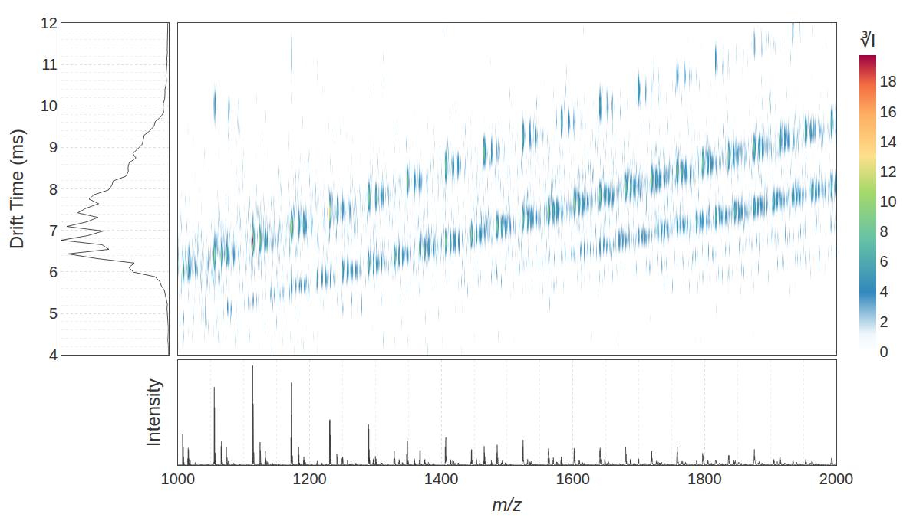

# Real Waters production demos

Seven complete acquired Waters RAW folders (235.75 MiB, 106 files) provide a protein-calibrant workflow for ADP CCS and a separate small-molecule reference check. They include instrument metadata, function data and existing reader sidecars. No acquisition was synthesized, shortened or stripped to make it smaller.

Open the Waters workspace, choose a demo and a writable output folder, then click **Process & view**. The GUI draws native Matplotlib plots directly from converted MS/IM TXT; this step does not generate HTML. **Export portable HTML** separately creates a single-file Plotly viewer for an external browser. Each demo supplies its own display settings; calibration and analyte tables are optional inputs where supplied.

| Demo | Real runs | RAW size | What it exercises |
| --- | ---: | ---: | --- |
| Protein calibrants → ADP CCS (default) | 5 | 195.07 MiB | Three protein standards establish the curve for two ADP solution conditions; calibration review and 34 target rows |
| Tune mix + Betaine | 2 | 40.68 MiB | Six Hexakis references, calibration and independent analyte processing |

Choose **Protein calibrants + ADP CCS** for the ADP example. Its three standards populate the calibrant table and the two ADP acquisitions populate the analyte table. Enable CCS after reviewing the reference peaks and the warnings below. Betaine supplies a separate reference check; its single reference point cannot establish the multi-parameter curve used for ADP. Its recorded trap collision energy is also 40 eV, compared with 4 eV for the protein and ADP acquisitions.

## The acquired data

- Protein standards: `20260216_UBQ_DEN_NEW_V1`, `20260216_CYTC_DEN_NEW_V1`, `20260216_MYO_DEN_NEW_V1`.
- ADP conditions: `20260212_200UM_ADP_1M_EDDA_PH6_0`, `20260212_200UM_ADP_200MM_AMAC`.
- Small molecules: `20260320_AGILENT_TUNE_MIX_V2`, `20260320_BETAINE_V2`.

[demo_manifest.json](demo_manifest.json) lists every file, byte count, SHA256 hash, original header and relevant instrument settings. Its paths resolve beside the manifest. Table `raw_path` values resolve beside their CSV, so moving the demo folder preserves the configuration. Some original protein/ADP header dates report 2009 despite later filename prefixes; both are preserved, and the prefixes are not evidence of acquisition chronology.

## Recorded execution and calibration limits

All seven retained acquisitions converted at their original mass resolution and produced enhanced HTML viewers with Plotly embedded. Each viewer includes mass and drift bin controls, profile/stick display, cutoff fade, smoothing and intensity scaling. [validation.json](validation.json) retains the corresponding results from the earlier Linux-through-Wine execution check; selecting these records did not rerun the analysis.

The earlier v0.3.0 source and frozen Windows Console passed with the two complete tune-mix/Betaine RAW acquisitions: six calibrant peaks, one finite analyte CCS result, ten PNG outputs, and both offline viewing routes. Those recorded checks establish software execution for that version; the scientific calibration limits below still apply. New package checks are recorded separately from this retained dataset evidence.

| Calibration demo | Accepted software peak rows | Reported log-fit score | Reference peak drift interval | Application limit |
| --- | ---: | ---: | --- | --- |
| Protein standards + ADP | 25 | 0.874117 | 4.785–8.745 ms | Poor calibration fit; 30 of 34 exported ADP peaks fall below the reference drift interval |
| Tune mix + Betaine | 6 | 0.999915 | 4.235–14.355 ms | Betaine peak is 1.485 ms, below the reference drift interval |

The protein example deliberately preserves the existing reference sheet and peak-selection choices. Several low-charge myoglobin rows contain multiple mobility peaks. Its poor fit is a realistic reason to review peak assignments and calibration conditions before accepting CCS results. We did not remove points or change references to improve the score. The target labels are inherited candidate assignments, including alternatives at the same mass; they are not independent identity confirmations.

The small-molecule example exports a Betaine peak of 127.5 square angstroms versus the inherited reference of 121.3 square angstroms. This is an extrapolation, even though the calibrant fit score is high. Neither demo establishes quantitative CCS accuracy for new samples.

Protein standards and ADP share major recorded mobility settings, but their pusher periods differ and are read per run.

## Larger local production batch

The separately held myoglobin dataset contains 36 complete RAW folders across six solution conditions and three temperatures, with 1-hour and 24-hour measurements. Its RAW payload is 12.53 GiB; existing derived outputs make the whole local folder larger. It remains a local stress dataset to avoid adding many gigabytes to a demo download. Import its RAW folders in the workspace and use [carter_viewer_config.json](carter_viewer_config.json). No CCS curve for that batch is provided here.

## Reproduce the ADP CCS workflow

From the application source directory, with its Python environment active:

```bash
python -m deconvovo.waters_convert examples/production/protein_adp/raw -o output/demo-adp-converted --fn 1 --ms-bin 0 --im-bin 0
python -m deconvovo.imms_plot -i output/demo-adp-converted -o output/demo-adp-html --raw-dir examples/production/protein_adp/raw --config examples/production/protein_adp/viewer_config.json
python -m deconvovo.imms_ccs_calibrate -o output/demo-adp-ccs --data-dir output/demo-adp-converted --calibrant-csv examples/production/protein_adp/calibrants.csv --analyte-csv examples/production/protein_adp/analytes.csv
```

The GUI uses **Process & view** for conversion and native viewing, with **Calibrate & apply** or the CCS checkbox for the optional analysis. The HTML command above is an explicit export; the GUI provides **Export portable HTML** for that route. A Python installation is needed for these source commands; compiled applications bundle their runtime.

## Betaine acquisition: 1000–2000 m/z detail

In **Load real demo**, choose **Betaine · 1000–2000 m/z detail**, select a writable output folder, then process/view. This display preset opens the single complete Betaine acquisition. It supplies no CCS calibration; use the protein-calibrant example above for ADP CCS.

The [detail config](small_molecule/betaine_1000_2000_viewer_config.json) starts the native plot at 1000–2000 m/z and 4–12 ms, so the heatmap and linked profiles use that region's signal range. Native X/Y fields can widen directly from the full TXT data. The same configuration can be used for the separate HTML export, whose baked mass domain requires regeneration to widen. Cube-root display intensity, 6400 mass bins and native drift bins reveal the weaker signal. Light 0.1 Da and 0.07 ms heatmap smoothing improves visibility; the drift profile is unsmoothed. The acquired values remain unchanged.



These high-mass features are measured in the Betaine acquisition, but their chemical identities are unassigned. This view does not identify them as the Betaine ion near 118 m/z; the existing overview remains available to inspect that region.

From source, generate the separate portable HTML display:

```bash
python -m deconvovo.waters_convert examples/production/small_molecule/raw/20260320_BETAINE_V2.raw -o output/demo-betaine-converted --fn 1 --ms-bin 0 --im-bin 0
python -m deconvovo.imms_plot -i output/demo-betaine-converted -o output/demo-betaine-detail-html --raw-dir examples/production/small_molecule/raw/20260320_BETAINE_V2.raw --config examples/production/small_molecule/betaine_1000_2000_viewer_config.json
```
